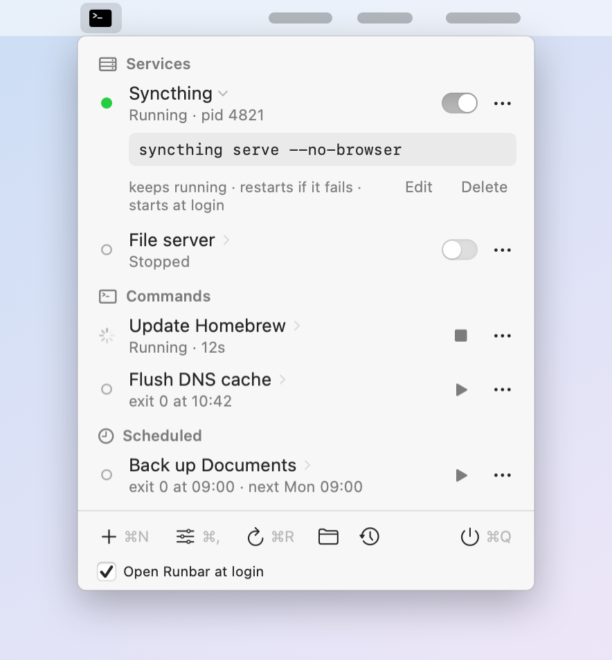

<p align="center">
  
</p>

<h1 align="center">Runbar</h1>

<p align="center">
  Start, stop and schedule your shell commands from the macOS menu bar,<br>
  so no terminal window has to stay open for them.
</p>

<p align="center">
  <picture>
    <source media="(prefers-color-scheme: dark)" srcset="docs/screenshot-dark.png">
    
  </picture>
</p>

## What it runs

Each item in the menu is one of three kinds:

| Kind | What it is for | How it runs |
|---|---|---|
| **service** | Something that should keep running: a sync daemon, a dev server | A launchd agent. It keeps running after Runbar quits, can restart when it fails, and can start at login. |
| **command** | Something you run now and then: an update, a cache flush | A child process. Click ▶ to run it and ■ to stop it. |
| **scheduled** | Something that runs on a timetable: a backup, a cleanup | A cron schedule, checked while Runbar is running. A run missed during sleep or while Runbar was closed runs once on wake or launch. |

## Features

- A panel that opens under the icon, stays open while you use it, and leaves the app you were in focused.
- A switch for each service, a run/stop button for each command, and a spinner while anything starts, stops or runs.
- Add, edit and delete items in the panel. Delete shows Undo for 5 seconds.
- A notification when something fails, with its log one click away. The icon shows the failure until you open the panel.
- The menu bar icon fills while something runs and pulses while a command is going.
- The config is a TOML file you can edit by hand. The panel's form keeps your comments.
- A `runbar://` URL scheme for Raycast, Shortcuts or shell aliases.
- No polling and no CPU use while idle.

## Requirements

- macOS 14 Sonoma or later
- Swift 5.10 or later to build it: Xcode, or the Command Line Tools (`xcode-select --install`)

## Install

There is no prebuilt download yet. Build it from source:

```bash
git clone https://github.com/lrisia/runbar.git
cd runbar
scripts/build.sh install
```

This builds `Runbar.app`, copies it to `~/Applications` and opens it. Then tick
**Open Runbar at login** at the bottom of the panel.

The app is signed ad hoc for the Mac that built it. A copy moved to another
Mac is blocked by Gatekeeper until you allow it under System Settings >
Privacy & Security, so build it on each Mac instead.

## Use it

Click the icon to open the panel. Click a row to see its command and settings,
and Edit or Delete it. The `⋯` button has Restart, Open Log and Copy Command.
Press `+` to add an item: pick its kind, then type the command and a name.

| Key | Action |
|---|---|
| ⌘N | Add an item |
| ⌘, | Open the config file |
| ⌘R | Reload the config |
| Esc | Leave the form, or close the panel |
| ⌘Q | Quit Runbar (services keep running) |
| ⌘-drag the icon | Move it along the menu bar |

## Config

The config lives at `~/.config/runbar/config.toml` and is created with
examples on first launch. Changes apply as soon as you save. If the file has
an error, the panel shows it and Runbar keeps using the last good config.

```toml
[settings]
icon = "terminal"               # SF Symbol name, or a path to an ~18 pt template PNG/PDF

[[sections]]
title = "Services"
icon = "server.rack"            # SF Symbol shown next to the section title

  [[sections.items]]
  id = "syncthing"              # letters, digits, . _ -
  name = "Syncthing"            # defaults to the id
  kind = "service"
  command = "syncthing serve --no-browser"
  restart = "on-failure"        # no (default) | on-failure | always
  autostart = false             # true: also start at login
  dir = "~"                     # working folder (default ~)
  env = { STNORESTART = "1" }

[[sections]]
title = "Scheduled"
icon = "clock"

  [[sections.items]]
  id = "backup"
  kind = "scheduled"
  schedule = "0 9 * * 1-5"      # minute hour day month weekday, or @daily, @hourly...
  catch_up = true               # run once after a missed time (default true)
  output = "silent"             # silent: notify on failure (default) | notify: every run
  command = "~/bin/backup.sh"
```

`restart` and `autostart` apply only to services, `schedule` and `catch_up`
only to scheduled items, and `output` to commands and scheduled items.

Editing a running service takes effect when you restart it; until then its row
says "config changed, restart to apply". Removing a service from the config
stops it and deletes its launchd agent.

To browse SF Symbols for the icons: `brew install --cask sf-symbols`.

### How commands run

Every command runs as
`<login shell> -ilc 'exec <login shell> -c "$RUNBAR_COMMAND"'`. The
interactive login shell loads your `PATH` and exports, then hands over to a
plain shell, because an interactive shell ignores SIGTERM and Stop would not
reach it. `RUNBAR=1` is set, so a slow `.zshrc` can skip interactive-only
setup:

```zsh
[[ -n $RUNBAR ]] && return
```

### Commands that need sudo

`sudo` cannot ask for a password here, because Runbar runs commands without a
terminal. Instead:

- **For a command you click:** let macOS ask for the password in a dialog.

  ```bash
  osascript -e 'do shell script "dscacheutil -flushcache" with administrator privileges'
  ```

- **For a service or scheduled item:** allow that one program without a
  password, then run it with `sudo -n`. Open the rule file with
  `sudo visudo -f /etc/sudoers.d/runbar` and add a line naming the full path
  of one program owned by root, never `ALL`:

  ```
  yourname ALL=(root) NOPASSWD: /opt/homebrew/bin/nginx
  ```

  If such a service ignores SIGTERM, Stop ends `sudo` but the program it
  started may keep running as root.

- **For a daemon that must run as root from boot:** use a LaunchDaemon in
  `/Library/LaunchDaemons` or `sudo brew services`. Runbar manages only your
  user's agents.

## URL scheme

```bash
open runbar://toggle/syncthing    # also start, stop, restart, run
open runbar://reload
open runbar://menu
```

## Files

| Path | What |
|---|---|
| `~/.config/runbar/config.toml` | Config |
| `~/Library/Logs/runbar/<id>.log` | Output of each item, moved to `.log.1` past 5 MB |
| `~/Library/Logs/runbar/history.log` | One line per command or scheduled run |
| `~/Library/LaunchAgents/local.runbar.<id>.plist` | Services with `autostart = true` |
| `~/Library/Application Support/runbar/agents/` | Services started only from the panel |
| `~/Library/Application Support/runbar/loaded/` | The definition each service was last started with |
| `~/Library/Application Support/runbar/state.json` | When each schedule last ran |

## How it stays light

Runbar never polls. It reads service state with one `launchctl list` when the
panel opens, after an action, and when a watched process exits (kqueue process
events). It watches the config with file-system events. Idle CPU use is zero.

## Uninstall

1. Remove every item from the config. This stops the services and deletes
   their launchd agents.
2. Quit Runbar.
3. Delete `~/Applications/Runbar.app`, `~/.config/runbar`,
   `~/Library/Logs/runbar` and `~/Library/Application Support/runbar`.

## Development

```bash
swift build          # debug build
swift test           # unit tests for the config, cron and launchd parts
scripts/build.sh     # Runbar.app in build/, without installing
```

`Sources/RunbarCore` holds the parts with no UI: config loading and editing,
cron, and launchd definitions. `Sources/runbar` is the app.

The app icon is drawn by `scripts/icon.swift`. After changing it, run
`swift scripts/icon.swift` to rewrite `Resources/AppIcon.icns`.
